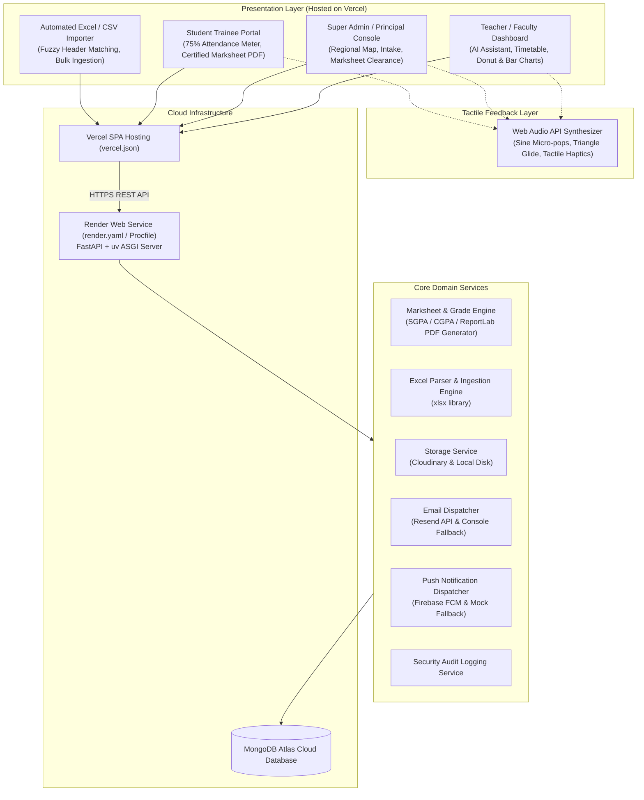
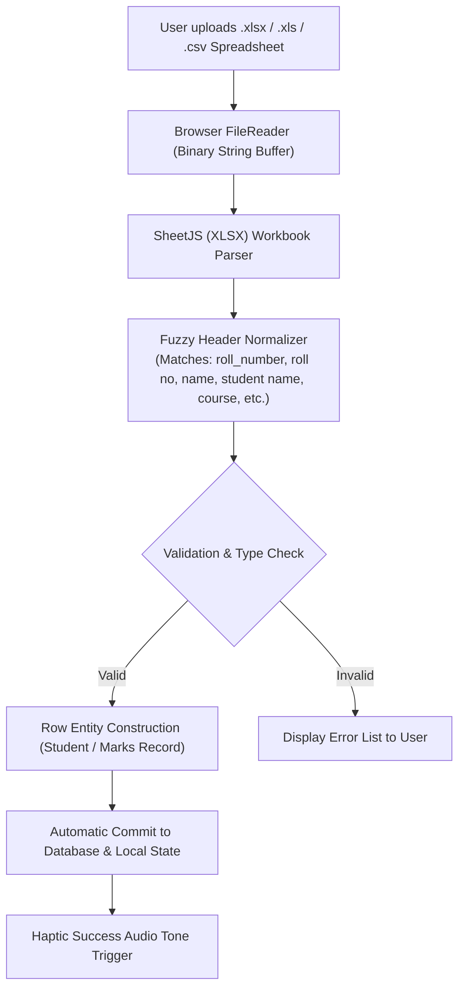
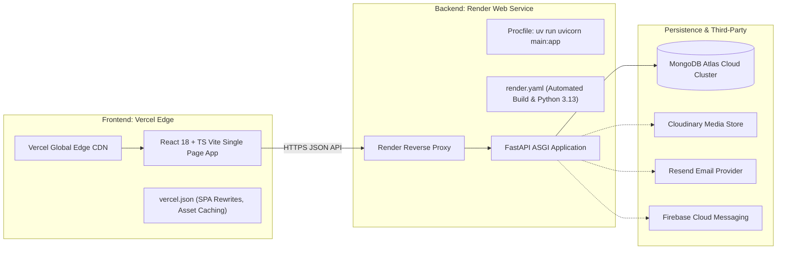
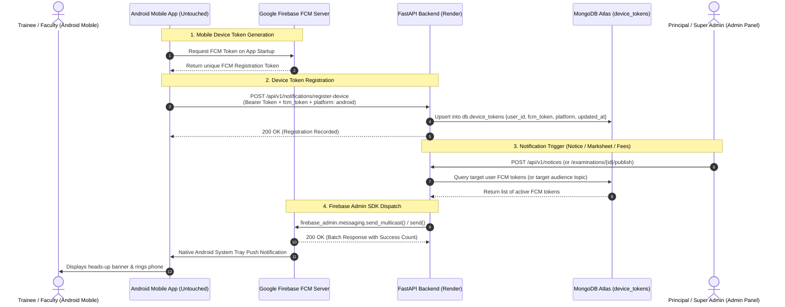

# System Architecture & Engineering Specification
## Annapurna Memorial College ERP & Sundarban Ashutosh B.Ed. College

> **Document Version:** 2.0.0 (Production)  
> **Status:** Active & Implemented  
> **Deployment Architecture:** Backend on **Render** (Python ASGI), Admin Panel on **Vercel** (Edge SPA), Persistence on **MongoDB Atlas**  
> **Affiliation:** Baba Saheb Ambedkar Education University (BSAEU / WBUTTEPA) & NCTE Recognized  

---

## 1. Executive Summary & Domain Scope

The **Annapurna Memorial College ERP** is a unified, enterprise-grade Higher Education Institution management engine designed specifically for teacher education colleges (offering B.Ed., D.El.Ed., and Integrated B.A. Education programs) and university colleges. 

The system features:
1. **Three Dedicated Role Portals**:
   - **Teacher / Faculty Screen**: Replicating modern AI-assisted educational ERP layout with live class status, timetable, interactive Homework Submissions Donut chart with fluid movement, Student Performance bar chart, AI Lesson Planner, and student risk alerts.
   - **Super Admin / Principal Executive Screen**: Institutional command center with interactive regional trainee distribution map (South 24 Parganas delta: Kakdwip, Namkhana, Diamond Harbour, Patharpratima, Kulpi), revenue & fee collection rate, and direct 1-click marksheet authorization.
   - **Student / Trainee Screen**: Personal portal with NCTE 75% physical attendance compliance meter, official certified semester marksheet with 1-click PDF download, fee ledger, and study materials repository.
2. **End-to-End Excel Data Import Engine**:
   - Automatic spreadsheet parsing (`.xlsx`, `.xls`, `.csv`) with fuzzy header resolution (`Roll`, `Name`, `Course`, `Session`, `Semester`, `Category`, `Guardian`).
   - One-click import directly into MongoDB and reactive frontend state with pre-configured sample `.xlsx` template generator.
3. **Multi-Stage Marksheet Approval Workflow**: A robust state machine ensuring grade integrity from raw faculty score entries through departmental checks and administrative authorization to official public issuance.
4. **BSAEU & NCTE Compliance Engine**: Automated calculation of SGPA, CGPA, letter grades, attendance eligibility thresholds (minimum 75% rule), and practicum file verification.
5. **Hardware-Accelerated Web Audio Haptic Engine**: Tactile sound effects for button clicks, frequency-glide tab navigation, haptic pulses, and a triumphant harmonic chord upon approving/publishing marksheets, toggleable via the header sound switch.
6. **Resilient Micro-services & Integrations**: Cloudinary document vault with local storage fallback, Resend transactional emails with structured console fallback, and Firebase FCM push notifications with simulated dispatch fallbacks.
7. **Strict No-Emoji Standards**: 100% clean UI built exclusively using official Lucide SVG icons, vector assets, and badge chips.

---

## 2. High-Level System Architecture

---

## 3. Marksheet Approval State Machine & Pipeline

---

## 4. End-to-End Excel Ingestion Architecture

---

## 5. Deployment Topology (Render & Vercel)

---

## 6. Mobile Push Notification Architecture (Firebase Cloud Messaging - FCM)

### Firebase Setup & Deployment Guide:
1. **Google Firebase Console Setup**:
   - Go to [Firebase Console](https://console.firebase.google.com/) and create/select project `annapurna-memorial-college-erp`.
   - **For Mobile (`annapurna-memorial-college-erp-app`)**:
     - Register Android app with Package Name (e.g. `com.annapurnacollege.erp`).
     - Download `google-services.json` and place it in the Android project `app/` directory.
   - **For Backend (`annapurna-memorial-college-erp-backend`)**:
     - Go to **Project Settings** ➔ **Service accounts** ➔ **Firebase Admin SDK**.
     - Click **Generate new private key** and download the JSON file.
     - Save this file locally in `annapurna-memorial-college-erp-backend/` as `firebase-service-account.json`.
     - In `.env` (already pre-configured): `FIREBASE_CREDENTIALS_PATH="firebase-service-account.json"`.
     - *Security Guarantee:* `firebase-service-account*.json` is protected in `.gitignore` and will never be pushed to GitHub.
   - **For Render Deployment**:
     - On Render.com backend dashboard, add an **Environment Secret File** named `firebase-service-account.json` containing the contents of your downloaded service account JSON.
     - Set the environment variable `FIREBASE_CREDENTIALS_PATH=/etc/secrets/firebase-service-account.json` (or relative path).

