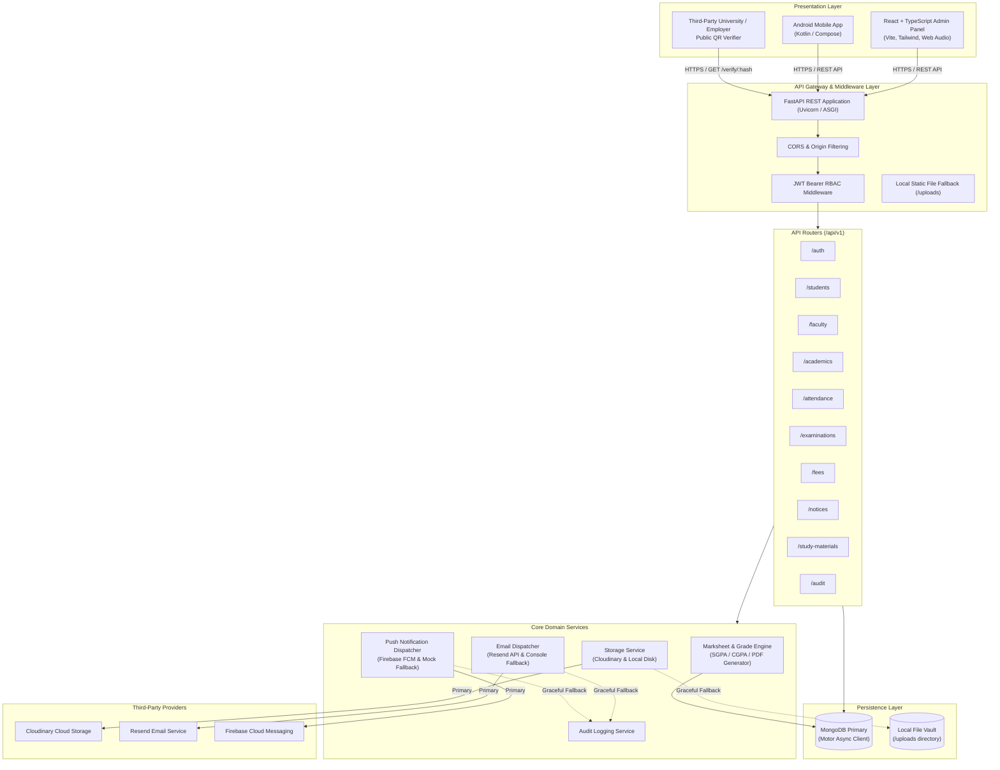
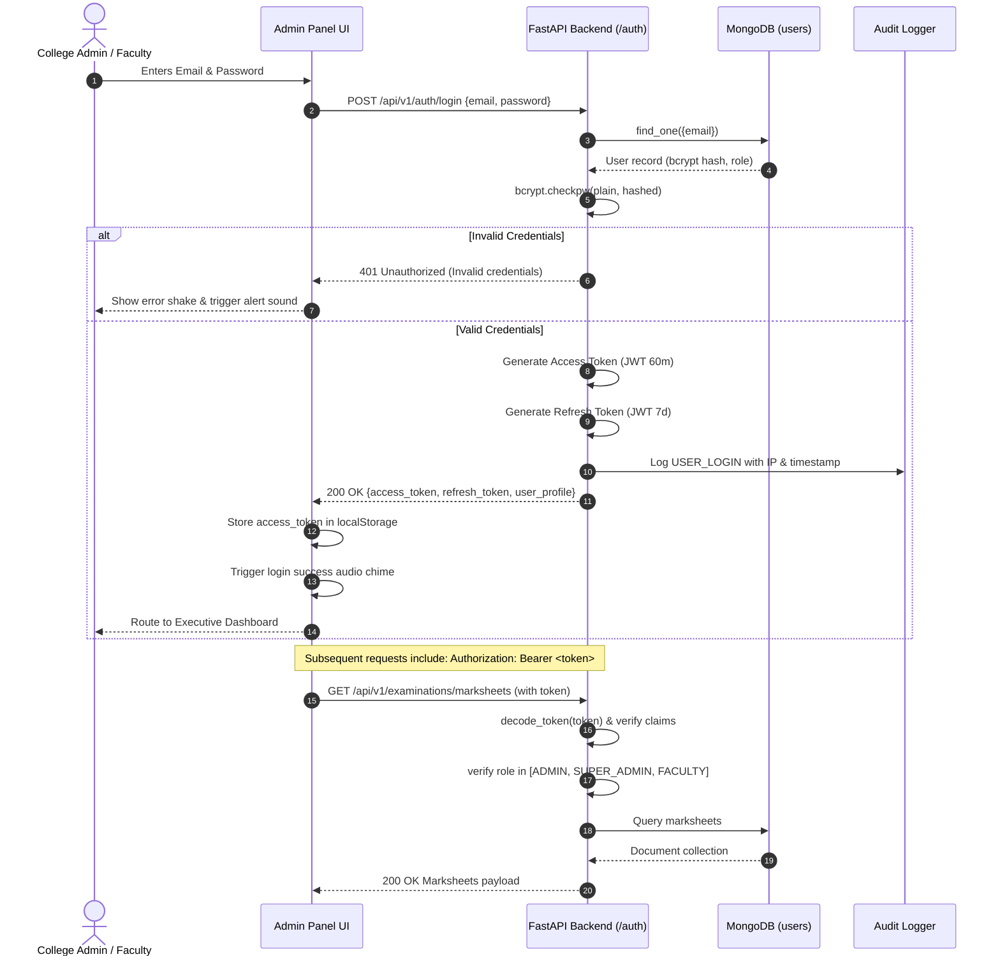
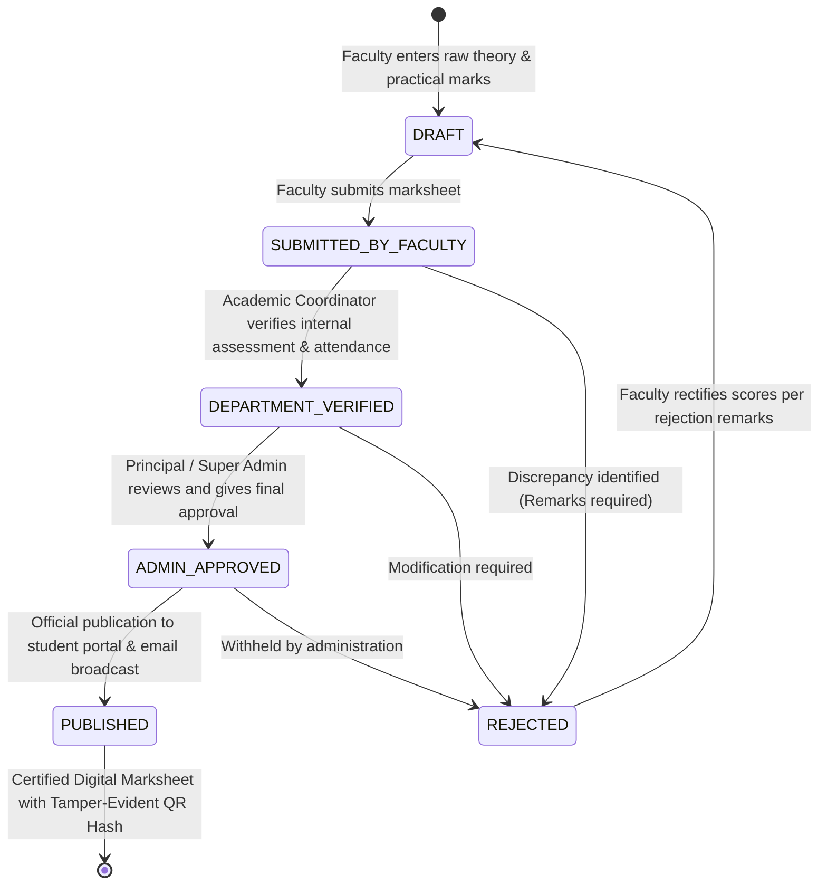
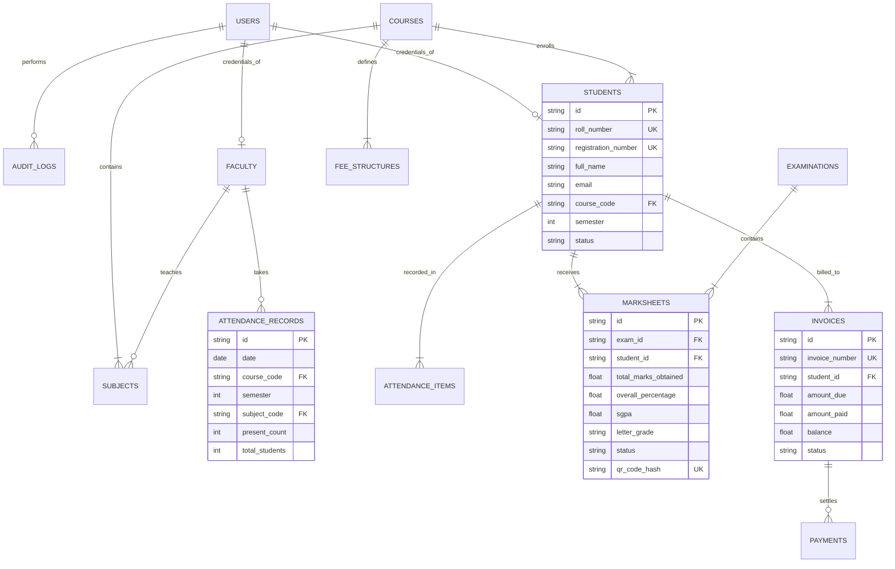
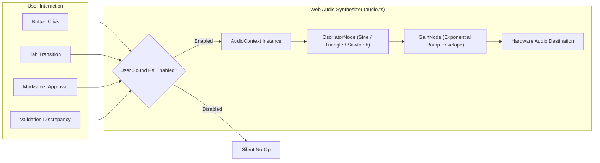
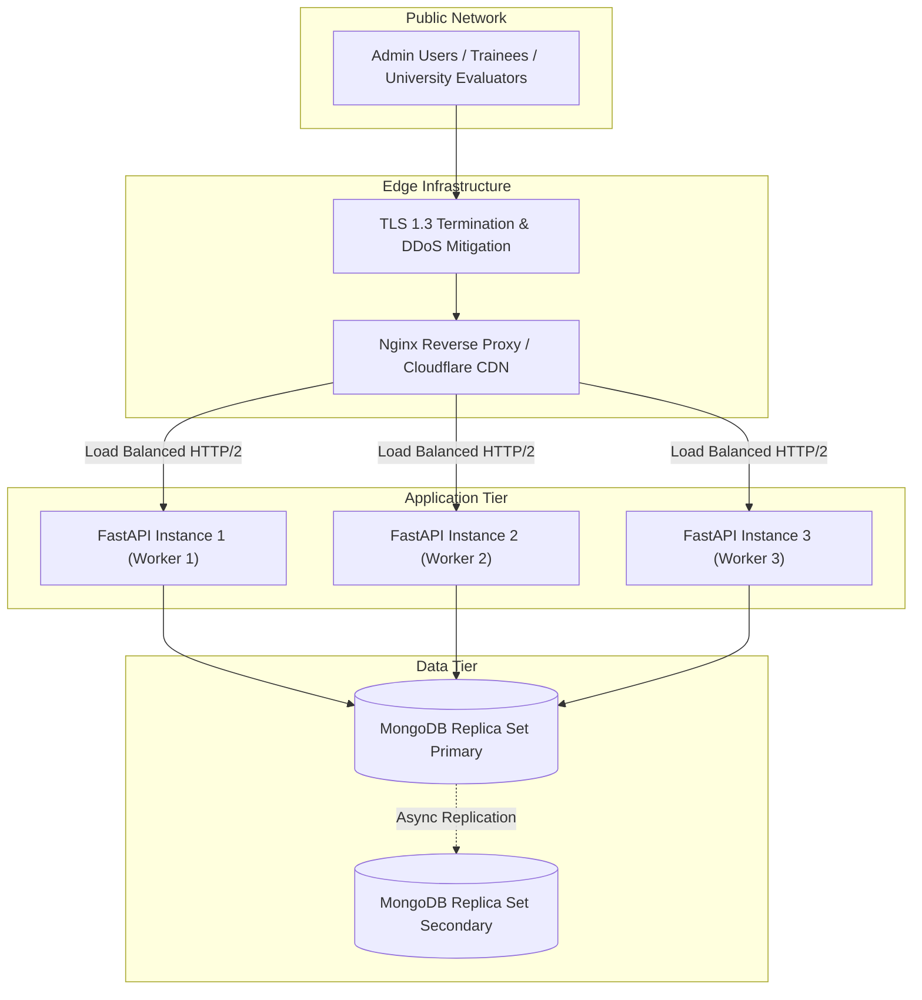

# System Architecture & Engineering Specification
## Annapurna Memorial College ERP & Sundarban Ashutosh B.Ed. College

> **Document Version:** 1.0.0 (Production)  
> **Status:** Active & Implemented  
> **Author:** Principal Systems Architect & Senior Full-Stack Engineer  
> **Affiliation:** Baba Saheb Ambedkar Education University (BSAEU / WBUTTEPA) & NCTE Recognized  

---

## 1. Executive Summary & Domain Scope

The **Annapurna Memorial College ERP** is a unified, enterprise-grade Higher Education Institution management engine designed specifically for teacher education colleges (offering B.Ed., D.El.Ed., and Integrated B.A. Education programs) and university colleges. 

The system features:
1. **Multi-Stage Marksheet Approval Workflow**: A robust state machine ensuring grade integrity from raw faculty score entries through departmental checks and administrative authorization to official public issuance.
2. **BSAEU & NCTE Compliance Engine**: Automated calculation of SGPA, CGPA, letter grades, attendance eligibility thresholds (minimum 75% rule), and practicum file verification.
3. **Resilient Micro-services & Integrations**: Cloudinary document vault with local storage fallback, Resend transactional emails with structured console fallback, and Firebase FCM push notifications with simulated dispatch fallbacks.
4. **Web Audio Micro-Interaction Synthesizer**: Hardware-accelerated native Web Audio API audio synthesis in the frontend admin panel providing immediate tactile user feedback without external asset latency.

---

## 2. High-Level System Architecture

The following diagram illustrates the structural topology of the application, showing client interfaces, FastAPI backend micro-routers, database persistence, and external service fallbacks.

---

## 3. Authentication & RBAC Lifecycle

Authentication uses JSON Web Tokens (JWT) using the `HS256` symmetric signing algorithm with distinct access tokens (60 minutes) and refresh tokens (7 days).

---

## 4. Marksheet Approval State Machine & Pipeline

The marksheet workflow is an immutable state machine designed to eliminate unauthorized grade alterations and maintain complete auditability:

### Transition Enforcement Matrix
| Transition | Allowed Roles | Mandatory Conditions | Triggered Event |
| :--- | :--- | :--- | :--- |
| `DRAFT` ➔ `SUBMITTED_BY_FACULTY` | `FACULTY`, `ADMIN`, `SUPER_ADMIN` | All subject scores entered within max limits | Audit log recorded |
| `SUBMITTED_BY_FACULTY` ➔ `DEPARTMENT_VERIFIED` | `ADMIN`, `SUPER_ADMIN` | Attendance prerequisite verified (≥ 75%) | Audit log recorded |
| `DEPARTMENT_VERIFIED` ➔ `ADMIN_APPROVED` | `ADMIN`, `SUPER_ADMIN` (Principal) | Academic committee review complete | Audit log recorded |
| `ADMIN_APPROVED` ➔ `PUBLISHED` | `SUPER_ADMIN` | Final approval from Controller of Examinations | Email sent, QR hash active |
| Any stage ➔ `REJECTED` | Reviewing Role | Mandatory `rejection_reason` / audit notes | Faculty alerted |

---

## 5. Entity-Relationship Data Model (ERD)

The MongoDB document schema models collegiate relationships between students, faculty, examinations, marksheets, attendance sessions, and financial ledgers:

---

## 6. Resilient Third-Party Integration Architecture

```mermaid
flowchart TD
    subgraph UploadPipeline["Media & Document Storage Pipeline"]
        UploadReq["File Upload Request (e.g. Student Document / Syllabus)"]
        CheckCloudinary{"Cloudinary Keys Configured?"}
        CloudinaryUpload["Upload to Cloudinary via SDK"]
        LocalDiskFallback["Write to Local static uploads/ directory"]
        ReturnURL["Return Storage URL (/uploads/... or cloudinary.com)"]

        UploadReq --> CheckCloudinary
        CheckCloudinary -->|Yes| CloudinaryUpload
        CheckCloudinary -->|No / Failed| LocalDiskFallback
        CloudinaryUpload --> ReturnURL
        LocalDiskFallback --> ReturnURL
    end

    subgraph EmailPipeline["Transactional Email Pipeline"]
        EmailReq["Email Request (Password Reset / Marksheet Published)"]
        CheckResend{"Resend API Key Configured?"}
        ResendSend["Dispatch via Resend API"]
        ConsoleFallback["Simulate Email: Output to Structured Log"]

        EmailReq --> CheckResend
        CheckResend -->|Yes| ResendSend
        CheckResend -->|No / Failed| ConsoleFallback
    end

    subgraph PushPipeline["FCM Push Notification Pipeline"]
        PushReq["Push Alert (Urgent Notice / Exam Announcement)"]
        CheckFirebase{"Firebase Credentials Present?"}
        FCMSend["Dispatch Multicast via Firebase Admin SDK"]
        MockPushFallback["Simulate Push Notification to Log"]

        PushReq --> CheckFirebase
        CheckFirebase -->|Yes| FCMSend
        CheckFirebase -->|No / Failed| MockPushFallback
    end
```

---

## 7. Web Audio Micro-Interaction Synthesizer Architecture

The Admin Panel includes a zero-dependency sound synthesizer implemented natively through the browser's `AudioContext`.

### Micro-interaction Acoustic Specs:
1. **Click Pop**: Sine wave frequency ramp from $880\text{ Hz} \to 320\text{ Hz}$ with exponential decay over $45\text{ ms}$.
2. **Tab Transition**: Triangle wave sweep $440\text{ Hz} \to 720\text{ Hz}$ over $80\text{ ms}$.
3. **Success Chime**: Major third harmonic progression ($C_5 = 523.25\text{ Hz} \to E_5 = 659.25\text{ Hz} \to G_5 = 783.99\text{ Hz}$) cascaded across $250\text{ ms}$.
4. **Official Marksheet Approval Chord**: Full A-Major resonant chord ($A_4 = 440\text{ Hz}, C\#_5 = 554.37\text{ Hz}, E_5 = 659.25\text{ Hz}, A_5 = 880\text{ Hz}$) sustained over $400\text{ ms}$.
5. **Rejection Alert**: Low frequency sawtooth drop $260\text{ Hz} \to 180\text{ Hz}$ over $130\text{ ms}$.

---

## 8. Deployment, Scalability & Security Topology

---

## 9. Verification & Quality Assurance Runbook

### Backend Verification
- Package Management: `uv`
- Dependency Resolution: Fast lockfile synchronization (`uv sync`)
- Test Coverage: Pytest async suite (`uv run pytest`)
  - Authentication & Token Claims
  - Student Admission CRUD
  - Marksheet Pipeline State Machine Transitions & Rejection Rules
  - ReportLab PDF Generation
  - Public Cryptographic Hash Verification
  - Fee Ledger Invoicing & Payments

### Frontend Verification
- TypeScript Strict Mode Compilation (`tsc`)
- Vite Bundle Production Build (`vite build`)
- Cross-browser Web Audio compatibility with audio resume gesture handler
- Zero missing module imports or CSS class collisions
